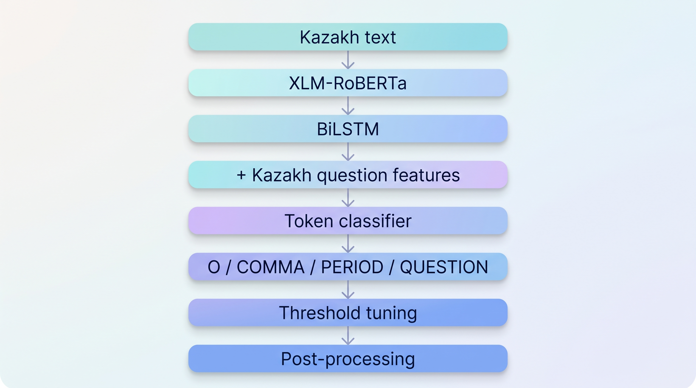

# Kazakh Punctuation Restoration

Transformer-based punctuation restoration for Kazakh text using XLM-RoBERTa, BiLSTM, focal loss, threshold optimization, and language-specific post-processing.

<p align="left">
  
  
  
  
</p>

## Overview

Automatic Speech Recognition systems and other text-processing pipelines often produce text without punctuation. This project explores punctuation restoration for Kazakh as a token classification task.

Given an unpunctuated sequence of words, the model predicts one of four labels for each word:

| Label | Meaning |
| --- | --- |
| `O` | No punctuation |
| `COMMA` | Comma |
| `PERIOD` | Sentence-ending punctuation |
| `QUESTION` | Question mark |

The project was originally developed during a hackathon and later reorganized into a reusable training and inference pipeline.

## Example

Illustrative example:

**Input**

```text
бүгін ауа райы жақсы бірақ кешке жаңбыр жаууы мүмкін сен қолшатыр алдың ба
```

**Restored text**

```text
Бүгін ауа райы жақсы, бірақ кешке жаңбыр жаууы мүмкін. Сен қолшатыр алдың ба?
```

The example above is created for demonstration and is not taken from the hackathon dataset.

## Highlights

- XLM-RoBERTa as the main multilingual transformer backbone
- optional Kazakh-specific RoBERTa backbone
- bidirectional LSTM sequence modeling head
- focal loss for severe class imbalance
- different learning rates for transformer and classification layers
- subword-to-word label alignment
- overlapping windows for longer sequences
- center-weighted merging of overlapping predictions
- per-class threshold optimization
- Kazakh-specific question-word and question-particle features
- rule-based post-processing
- optional model ensembling
- support for additional Kazakh training text

## Architecture

<p align="center">
  
</p>

The core architecture combines a pretrained transformer encoder with a bidirectional LSTM and a token-level classification head.

```text
Transformer encoder
        +
Bidirectional LSTM
        +
Kazakh-specific linguistic features
        +
Token classification head
```

The implemented model supports both multilingual and Kazakh-specific transformer backbones.

## Class Imbalance

One of the main challenges in the hackathon dataset was severe label imbalance.

The original training set contained only a very small number of `QUESTION` labels compared with `O`, `COMMA`, and `PERIOD`.

The pipeline therefore uses several strategies to improve rare-class learning:

- weighted focal loss;
- oversampling of question-containing examples;
- additional Kazakh text;
- explicit Kazakh question markers;
- class-specific decision thresholds.

The focal loss applies stronger weighting to rare punctuation classes instead of treating every token equally.

## Kazakh-Specific Features

The model includes lightweight linguistic features designed for Kazakh question detection.

Examples include question particles such as:

```text
ма, ме, ба, бе, па, пе, мы, мі, бы, бі, пы, пі
```

and question words such as:

```text
кім, не, қайда, қашан, қалай, неше, қанша, неге, қандай
```

These features are concatenated with the BiLSTM representation before token classification.

## Training Data

The hackathon data follow a token-level format where each word has a corresponding punctuation label.

Conceptually:

```text
input_text,labels
<space separated words>,<space separated labels>
```

Example structure:

```text
word1 word2 word3 word4
O O COMMA PERIOD
```

The original hackathon train and test files are not distributed through this repository.

The pipeline can also build additional training examples from appropriately licensed Kazakh text.

## Additional Data

The experimental pipeline includes utilities for converting punctuated Kazakh text into token-level training examples.

During development, additional Kazakh-language text was explored to increase training coverage and reduce class imbalance.

The preprocessing pipeline:

1. cleans source text;
2. identifies punctuation attached to tokens;
3. removes punctuation from the input;
4. converts punctuation marks into token labels;
5. creates training chunks;
6. increases the representation of rare question examples.

No downloaded corpora are included in this repository.

## Dataset Processing

The custom dataset implementation handles subword tokenization explicitly.

Only the first subtoken of each original word receives the punctuation label. Remaining subtokens are ignored during loss calculation.

For long sequences, the input is split into overlapping windows.

This makes it possible to preserve contextual information while processing sequences longer than a single model window.

## Model

The primary backbone used in the hackathon experiments was:

```text
xlm-roberta-large
```

The pipeline also supports:

```text
nur-dev/roberta-kaz-large
```

The classification architecture is:

```text
Transformer
    ↓
Dropout
    ↓
Bidirectional LSTM
    ↓
Kazakh linguistic features
    ↓
Feed-forward classifier
    ↓
O / COMMA / PERIOD / QUESTION
```

The BiLSTM captures additional sequential information on top of contextual transformer representations.

## Loss Function

The project uses focal loss to reduce the effect of the dominant `O` class and place more emphasis on difficult and rare punctuation examples.

The development configuration uses:

```text
gamma = 2.0
```

with class-specific weights for:

```text
O
COMMA
PERIOD
QUESTION
```

The rare `QUESTION` class receives the largest weight.

## Threshold Optimization

Instead of relying only on `argmax`, the pipeline can optimize separate probability thresholds for:

```text
COMMA
PERIOD
QUESTION
```

Thresholds are optimized on validation predictions using the Nelder-Mead algorithm.

Rare classes are evaluated independently, allowing the decision rule to be adjusted for highly imbalanced punctuation labels.

## Inference

Long sequences are processed using overlapping windows.

When the same word appears in multiple windows, predictions are merged using position-based weighting. Predictions closer to the center of a window receive greater weight than predictions near the window boundaries.

This reduces boundary artifacts produced by chunked inference.

## Post-processing

The pipeline also includes optional Kazakh-specific post-processing.

Examples include:

- handling known interrogative particles;
- detecting likely question endings;
- resolving consecutive sentence-ending predictions;
- ensuring that the number of output labels matches the number of input words.

The rule-based layer is applied after neural model inference.

## Ensemble Support

The code supports combining predictions from multiple trained models.

For example:

```text
XLM-RoBERTa
+
Kazakh RoBERTa
```

Model logits can be averaged before thresholding and post-processing.

## Repository Structure

```text
kazakh-punctuation-restoration/
├── README.md
├── requirements.txt
├── .gitignore
│
├── assets/
│   ├── architecture.png
│   └── demo.gif
│
├── configs/
│   └── xlm_roberta.yaml
│
├── docs/
│   └── data_format.md
│
├── scripts/
│   ├── build_extra_data.py
│   ├── evaluate.py
│   ├── predict.py
│   └── train.py
│
└── src/
    └── kazpunct/
        ├── __init__.py
        ├── constants.py
        ├── data.py
        ├── dataset.py
        ├── inference.py
        ├── losses.py
        ├── metrics.py
        ├── model.py
        ├── postprocessing.py
        └── training.py
```

## Installation

Clone the repository:

```bash
git clone git@github.com:MikaLinni/kazakh-punctuation-restoration.git
cd kazakh-punctuation-restoration
```

Create a virtual environment:

```bash
python3 -m venv .venv
source .venv/bin/activate
```

Install dependencies:

```bash
pip install -r requirements.txt
```

## Training

Train a model using a labeled CSV file:

```bash
python scripts/train.py \
  --train-file /path/to/train.csv
```

Additional parameters can be configured in:

```text
configs/xlm_roberta.yaml
```

The training pipeline supports:

- gradient accumulation;
- mixed precision;
- cosine learning-rate scheduling;
- gradient clipping;
- focal loss;
- validation Macro F1;
- model checkpointing.

## Building Additional Training Data

Additional Kazakh text can be converted into punctuation-restoration training examples using:

```bash
python scripts/build_extra_data.py
```

The generated data are intended for local experimentation and are not committed to the repository.

## Evaluation

Evaluate a trained checkpoint:

```bash
python scripts/evaluate.py \
  --model-path /path/to/checkpoint \
  --test-file /path/to/test.csv
```

The main evaluation metric used during development is Macro F1 over punctuation classes.

Per-class F1 scores can also be calculated for:

```text
COMMA
PERIOD
QUESTION
```

## Prediction

Generate punctuation labels for unseen text:

```bash
python scripts/predict.py \
  --model-path /path/to/checkpoint \
  --input-file /path/to/input.csv \
  --output-file outputs/predictions.csv
```

Generated prediction files are ignored by Git.

## Development Notes

The original hackathon training data were highly imbalanced, especially for the `QUESTION` class.

This motivated several parts of the final pipeline:

- focal loss instead of standard cross-entropy;
- rare-class oversampling;
- additional Kazakh text;
- linguistic question features;
- threshold optimization;
- rule-based post-processing.

The repository represents a cleaned and modularized version of the experimental hackathon code rather than a direct export of the original notebooks.

## Data Availability

Hackathon datasets are not distributed through this repository.

The repository does not contain:

- original train or test files;
- competition submissions;
- private datasets;
- trained checkpoints;
- model weights;
- cached external corpora.

Users should provide their own appropriately licensed or authorized data.

## Technologies

- Python
- PyTorch
- Hugging Face Transformers
- XLM-RoBERTa
- BiLSTM
- pandas
- NumPy
- scikit-learn
- SciPy
- Hugging Face Datasets

## Future Work

Possible extensions include:

- comparison of multilingual and Kazakh-specific transformer backbones;
- ablation studies for BiLSTM and linguistic features;
- improved long-document inference;
- model publishing on Hugging Face;
- inference API or interactive demo;
- evaluation on additional Kazakh domains.

## Author

**Meruert Bekmukhamedova**

GitHub: [@MikaLinni](https://github.com/MikaLinni)

## License

A software license has not yet been assigned to this repository.
